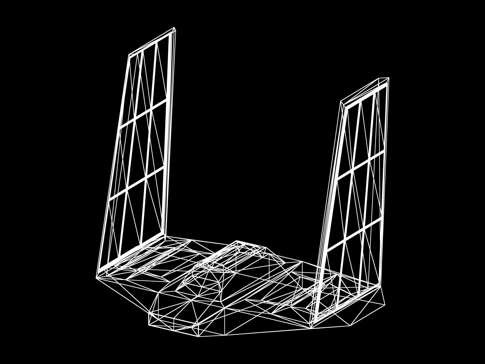
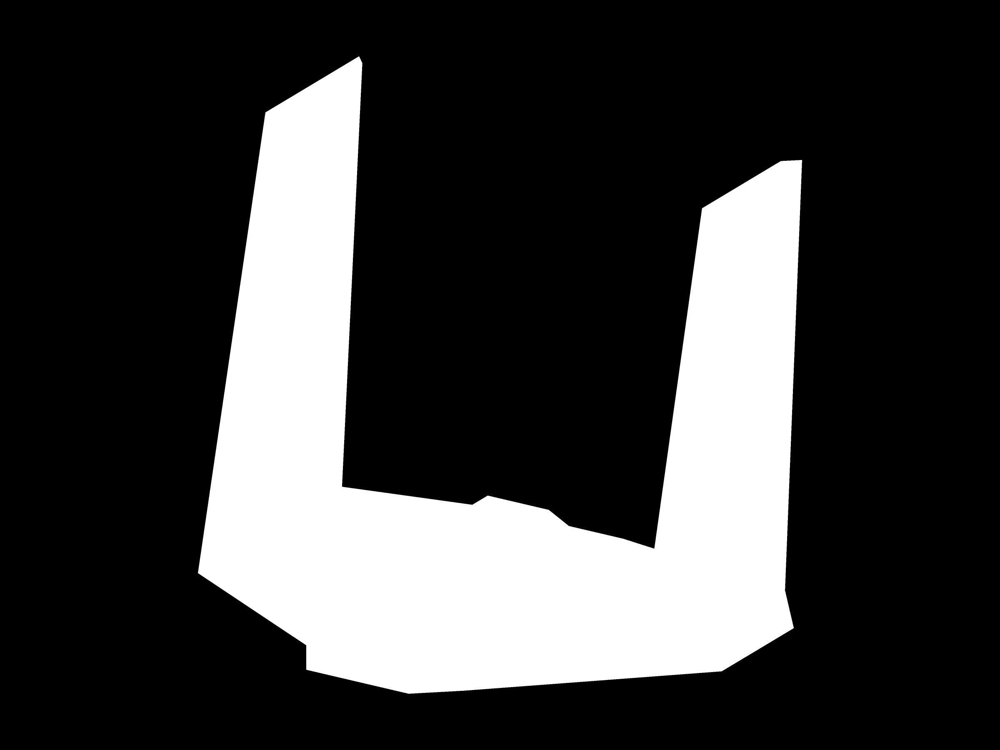
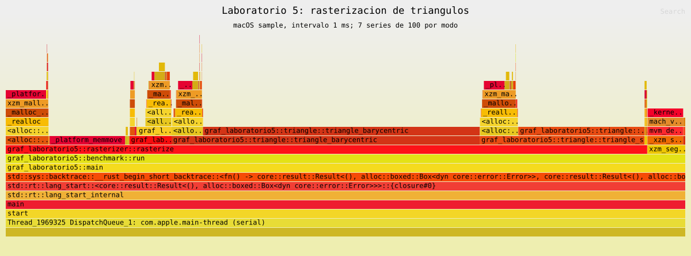

**Universidad del Valle de Guatemala**  
Gráficas por Computadora

# Laboratorio 5 — Rellenar triángulos

**Juan Francisco Orozco Mijangos — Carné 24647**

Se amplía el [laboratorio 4](https://github.com/juanfriorozco8/GRAF_laboratorio4) con dos métodos de relleno: coordenadas baricéntricas y líneas horizontales (*scanline*). Se conserva la nave, el cargador OBJ propio y el contorno con Bresenham.

## Ejecutar

Se requiere Rust con Cargo, CMake, compilador C/C++ y libclang para Raylib 5.5.1.

```sh
cargo run --release
```

## Algoritmos

- **Contorno:** tres llamadas a `line` conectan los vértices con Bresenham.
- **Baricéntrico:** recorre el rectángulo del triángulo y calcula las tres coordenadas baricéntricas en cada centro de píxel `(x + 0.5, y + 0.5)` para determinar si está dentro.
- **Scanline:** recorre filas horizontales, encuentra sus cruces con las aristas y genera los fragmentos entre ambos extremos.

Ambos rellenos utilizan blanco uniforme y la misma regla de bordes: incluyen el superior y el izquierdo, y excluyen el inferior y el derecho. Scanline usa el intervalo `[y_min, y_max)` y omite las aristas horizontales al buscar cruces; ajusta los extremos con la regla compartida para evitar diferencias de redondeo. Se normaliza el orden de los vértices y los triángulos de área cero producen cero fragmentos, sin dividir entre cero.

El modo cambia únicamente la rasterización. Los dos métodos devuelven `Vec<Fragment>` y comparten el ensamblaje y los shaders del curso. El framebuffer descarta los fragmentos exteriores.

La presentación usa Retina y supermuestreo para suavizar los bordes. La rasterización se calcula en la CPU; Raylib proporciona la imagen, textura y ventana. El blanco uniforme produce una silueta, sin iluminación ni z-buffer.

## Resultado

| Contorno | Baricéntrico | Scanline |
| --- | --- | --- |
|  |  |  |

## Comparación de resultados

Se compararon las posiciones de los fragmentos generados por ambos rellenos, utilizando el mismo color blanco y evaluando los mismos centros de píxel. **Cero diferencias significa que ambos algoritmos cubren exactamente las mismas posiciones.**

| Caso | Fragmentos baricéntricos | Fragmentos scanline | Diferencias |
| --- | ---: | ---: | ---: |
| Triángulo pequeño | 6 | 6 | 0 |
| Triángulo grande | 194815 | 194815 | 0 |
| Borde horizontal superior | 2800 | 2800 | 0 |
| Borde horizontal inferior | 2800 | 2800 | 0 |
| Borde vertical | 2800 | 2800 | 0 |
| Parcialmente fuera del framebuffer | 5125 | 5125 | 0 |
| Tres vértices colineales | 0 | 0 | 0 |

Invertir el orden de los vértices conservó el resultado en todos los casos. Las 692 caras de la nave también coincidieron individualmente, sin fragmentos duplicados dentro de una misma cara. Los dos PNG de relleno son idénticos byte a byte.

Los triángulos colineales no generan relleno. En el caso parcialmente exterior, 4139 de los 5125 fragmentos quedan dentro del framebuffer; los restantes se descartan al escribir la imagen. No se encontraron diferencias de borde entre los rellenos porque ambos aplican la misma regla superior/izquierda.

## Mediciones de rasterización

Equipo: **Apple M2 Pro, macOS 27.0.1 y Rust 1.97.0**. Se utilizó compilación `release` y la nave de 692 triángulos sobre una cuadrícula de **800 × 600**.

Después de un calentamiento, se realizaron **7 series de 100 rasterizaciones por modo**, rotando el orden entre series y tomando la mediana. `Instant` mide exclusivamente `rasterize`, y `black_box` conserva sus entradas y resultados. El tiempo incluye crear, almacenar y liberar los fragmentos. La carga del modelo, las transformaciones, el ensamblaje, el suavizado de presentación, la textura, la ventana y las esperas quedan fuera.

| Modo | Fragmentos por rasterización | Mediana de 100 rasterizaciones (ms) |
| --- | ---: | ---: |
| Contorno | 119360 | 104.321 |
| Baricéntrico | 256684 | 454.336 |
| Scanline | 256684 | 231.352 |

En esta medición, scanline fue aproximadamente **1.96 veces más rápido** que el relleno baricéntrico y produjo las mismas posiciones y cantidad de fragmentos. El método baricéntrico evalúa posiciones de todo el rectángulo del triángulo; scanline calcula los cruces por fila y recorre el tramo interior. Ambos conservan el costo de creación y crecimiento de los vectores.

El contorno realiza un trabajo diferente y su tiempo se incluye como referencia. Los conteos de la nave incluyen caras superpuestas, por lo que no equivalen a píxeles únicos visibles. Los tiempos pueden variar según el equipo y la carga del sistema.

## Perfil de ejecución



El [perfil SVG](docs/flamegraph.svg) contiene **2622 muestras** de una ejecución repetida sin ventana. En este Mac, el backend `xctrace` de cargo-flamegraph requería Xcode completo; se utilizó el perfilador `/usr/bin/sample` y se convirtió el muestreo a SVG.

| Función | Muestras inclusivas | Porcentaje del total |
| --- | ---: | ---: |
| `triangle_barycentric` | 1189 | 45.35 % |
| `triangle_scanline` | 636 | 24.26 % |

También aparecen `RawVec::grow_one`, realocaciones y copias de memoria. El perfil muestra que el costo combina el cálculo de cobertura con la creación y el almacenamiento de fragmentos. Reducir los cálculos geométricos no elimina el costo de los vectores.

El ancho de cada bloque representa la proporción de muestras en las que aparece una función, **no el orden de ejecución**. Los porcentajes son inclusivos y pueden superponerse; no deben sumarse. Las mediciones de tiempo de la tabla anterior se realizaron sin el perfilador activo.
